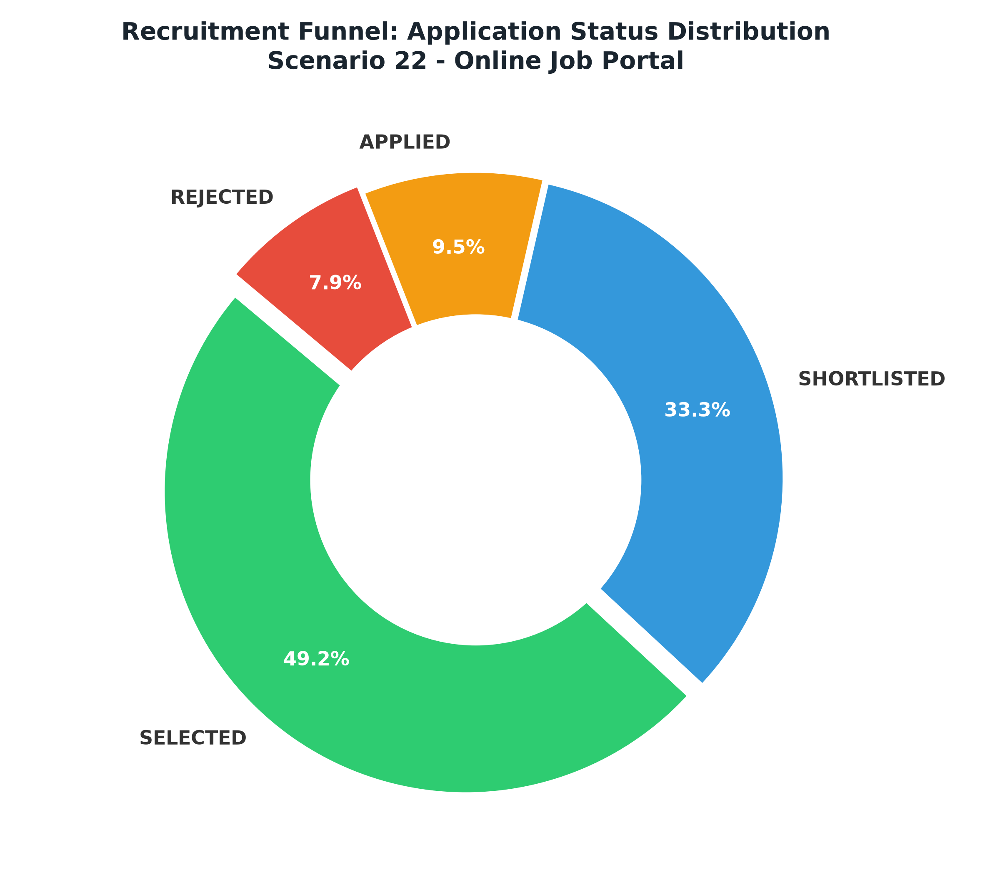
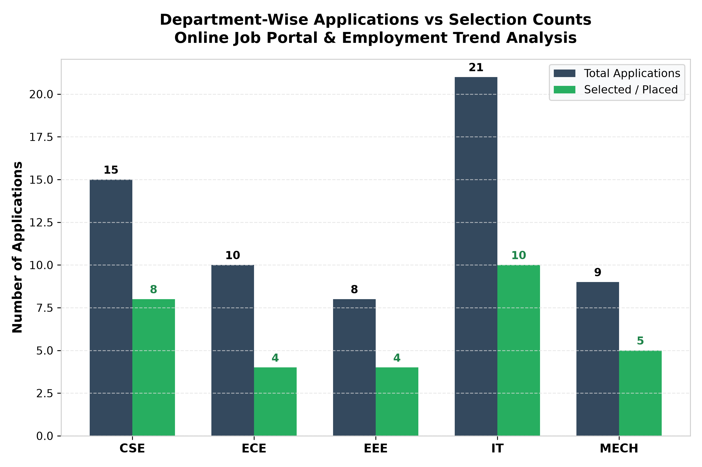
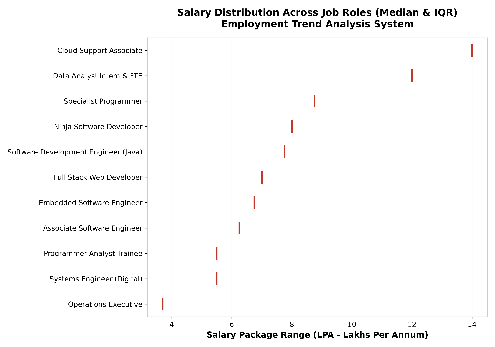
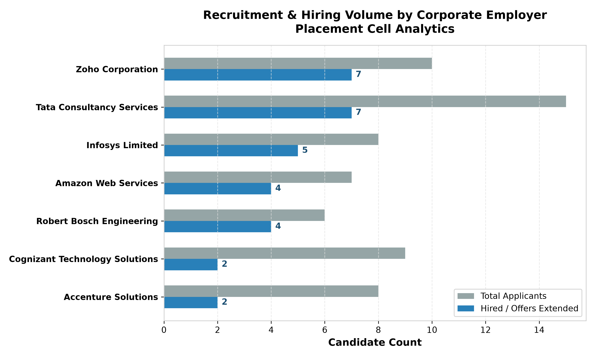
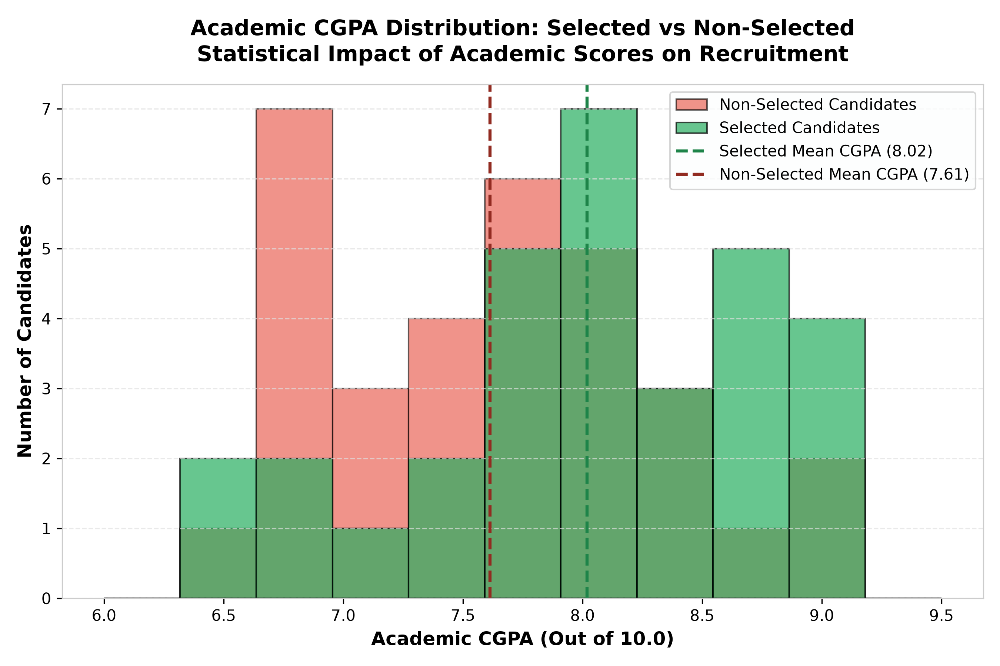
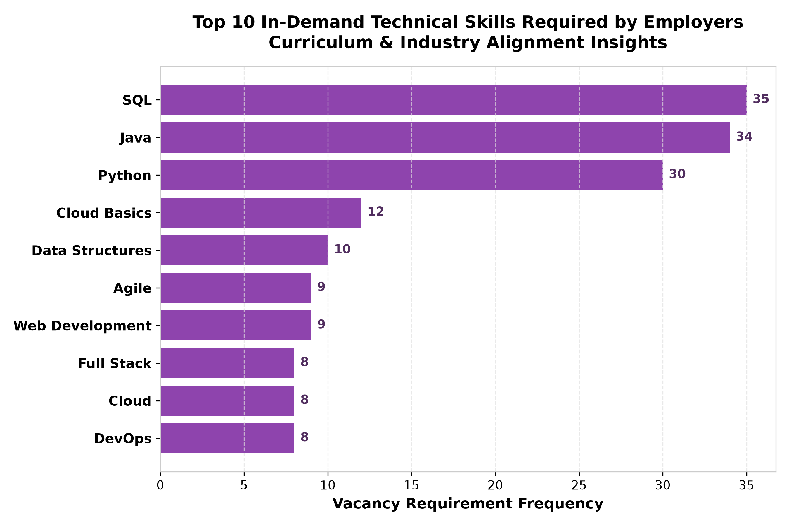
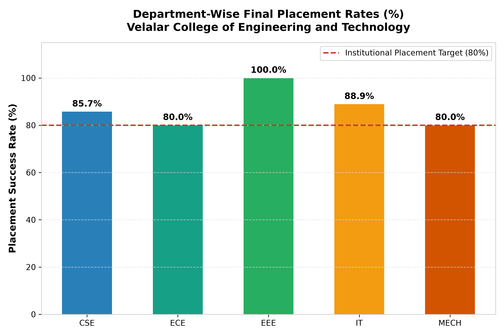
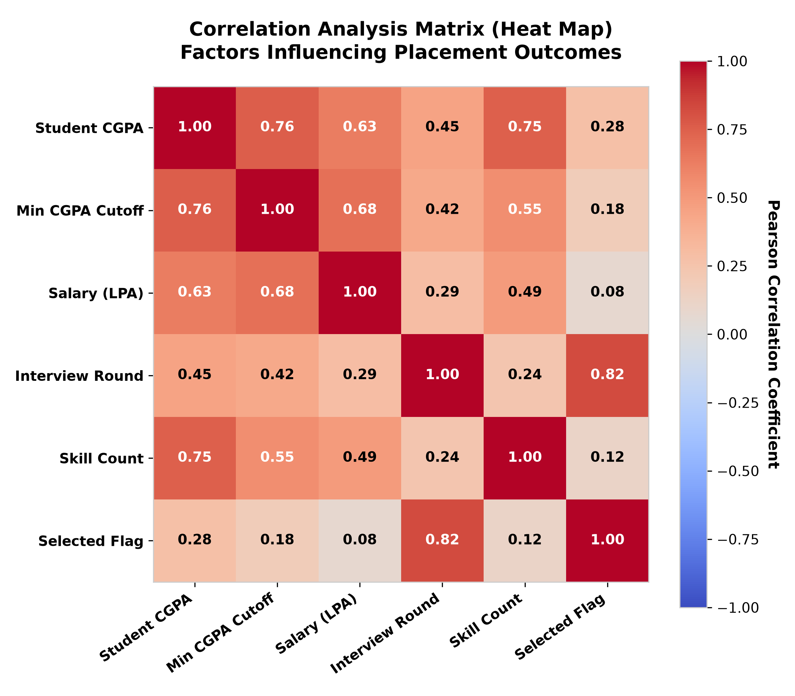

# Online Job Portal and Employment Trend Analysis System
### Scenario 22 | Project-Based Assessment

**Institution:** Velalar College of Engineering and Technology (Autonomous), Erode - 638012  
**Department:** Department of Information Technology  
**Academic Year:** 2026 - 2027 (ODD Semester)  
**Class & Section:** 25IT3A  
**Student Name:** Dharaneesh.K  
**Register Number:** 732925ITR022  

---

## 📌 Integrated Curriculum Courses
This project integrates core concepts across four fundamental engineering subjects:
1. **25ITT33 - Software Engineering**: Requirements Engineering (SRS IEEE 830), Architectural & Component Design (UML Use Case, Class, Sequence Diagrams), and Quality Assurance (Unit, Integration, White-Box & Black-Box Testing).
2. **25ITT32 - Java Programming**: Object-Oriented Programming (OOP), Custom Exceptions, Generics, Collections Framework, Multithreading (Async Notifier), Stream API, and Database Connectivity (JDBC).
3. **25ITT31 - Database Management Systems (DBMS)**: Relational Data Modeling, E-R Diagrams, DDL/DML, Constraints, Analytical SQL Joins & Subqueries, BCNF Normalization, and Query Optimization.
4. **25ITC31 - Foundations of Data Science**: Database Retrieval, Data Wrangling (Pandas/NumPy), Data Cleaning & Imputation, IQR Outlier Detection, and Exploratory Data Analysis (EDA) with Matplotlib & Seaborn.

---

## 🚀 Key Functional Capabilities (Scenario 22)

1. **Student / Job Seeker Profile Management**:
   - Maintains student ID, name, department (`IT`, `CSE`, `ECE`, `EEE`, `MECH`), qualification, CGPA (0.00 – 10.00), verified technical skills, email, and phone.
2. **Company & Job Vacancy Management**:
   - Maintains corporate employer profiles and publishes vacancies with minimum CGPA cutoffs, required skills, eligible departments, job location, openings count, and salary packages.
3. **Smart Eligibility Filtering**:
   - Dynamic validation engine comparing student CGPA and department against job criteria before permitting application. Throws `IneligibleCandidateException` for non-matching candidates.
4. **Strict Duplicate Application Prevention**:
   - Dual-layer protection (Database compound `UNIQUE(student_id, vacancy_id)` constraint + Java business service validation). Throws checked `DuplicateApplicationException`.
5. **Recruitment Pipeline Lifecycle Tracking**:
   - Real-time tracking of candidate progression: `APPLIED` $\rightarrow$ `SHORTLISTED` $\rightarrow$ `SELECTED` $\rightarrow$ `REJECTED`, complete with evaluation round numbers and interviewer remarks.
6. **Executive Placement Reporting Engine**:
   - Real-time tabular reports powered by Java Collections and Stream API: Vacancies Report, Application Pipeline Audit, Status Breakdown, and Department-wise Placement Rates.
7. **Python Data Science & Trend Analytics**:
   - Extracts relational data into analytical pipelines, cleans missing values, conducts IQR outlier analysis, and generates 8 publication-ready charts (300 DPI).

---

## 📂 Repository Directory Structure

```
Project1/
├── docs/                                  # Complete Engineering Documentation
│   ├── SRS.md                             # IEEE 830 Software Requirements Specification
│   ├── DESIGN_DIAGRAMS.md                 # System Architecture, UML Use Case, Class & Sequence Diagrams
│   ├── ER_RELATIONAL_MODEL.md             # ER Diagram, Relational Schema, and BCNF Normalization
│   └── TESTING_DOCUMENT.md                # Testing Techniques & 16-Case Test Execution Matrix
├── database/                              # Database Scripts & Persistence Engine
│   ├── schema.sql                         # DDL Schema with Tables, Constraints & Indexes
│   ├── seed_data.sql                      # Realistic Dataset (29 Students, 8 Companies, 12 Vacancies, 62 Apps)
│   ├── analytical_queries.sql             # Advanced SQL Analytics (Joins, Aggregations, Subqueries)
│   ├── init_db.py                         # Automated SQLite Database Provisioner
│   └── job_portal.db                      # SQLite Relational Database File
├── src/com/jobportal/                     # Enterprise Java Application Source Code
│   ├── Main.java                          # CLI Application Entry Point & Interactive Menu
│   ├── config/
│   │   └── DatabaseConnection.java       # Singleton JDBC Connection Manager
│   ├── model/
│   │   ├── Student.java                   # Student Entity
│   │   ├── Company.java                   # Company Entity
│   │   ├── Vacancy.java                   # Vacancy Entity
│   │   ├── Application.java               # Application Entity
│   │   └── ApplicationStatus.java         # Enum (APPLIED, SHORTLISTED, SELECTED, REJECTED)
│   ├── dao/
│   │   ├── StudentDAO.java                # Student Data Access Object
│   │   ├── CompanyDAO.java                # Company Data Access Object
│   │   ├── VacancyDAO.java                # Vacancy Data Access Object
│   │   └── ApplicationDAO.java            # Application Data Access Object
│   ├── service/
│   │   ├── JobPortalService.java          # Service Layer Interface
│   │   └── JobPortalServiceImpl.java      # Business Rules, Eligibility & Async Notifier
│   ├── exception/
│   │   ├── DuplicateApplicationException.java
│   │   ├── IneligibleCandidateException.java
│   │   └── RecordNotFoundException.java
│   └── util/
│       ├── InputValidator.java            # Regular Expression Input Validations
│       └── ReportGenerator.java           # Stream API Management Reports
├── python/                                # Foundations of Data Science EDA Suite
│   ├── db_retrieval.py                    # SQLite Extraction to Analytical CSV
│   ├── data_preprocessing.py              # Data Cleaning, IQR Outliers & Feature Engineering
│   ├── visualizations.py                  # High-Resolution Visualization Generator (8 Charts)
│   └── employment_trend_analysis.ipynb    # End-to-End Jupyter Notebook Pipeline
├── output/                                # System Outputs & Analytical Visualizations
│   ├── raw_placement_data.csv             # Extracted Master Placement Dataset
│   ├── cleaned_placement_data.csv         # Cleaned Dataset with Engineered Features
│   ├── sample_inputs_outputs.txt          # Actual Console Run Logs & Test Outputs
│   └── visualizations/                    # 8 High-Resolution Charts (300 DPI)
│       ├── 01_application_status_distribution.png
│       ├── 02_applications_per_department.png
│       ├── 03_salary_distribution_by_job_role.png
│       ├── 04_top_recruiting_companies.png
│       ├── 05_cgpa_vs_selection_correlation.png
│       ├── 06_skills_demand_frequency.png
│       ├── 07_placement_rate_by_department.png
│       └── 08_correlation_heatmap.png
├── lib/                                   # External Java Dependencies (Bundled)
│   ├── sqlite-jdbc-3.45.1.0.jar           # SQLite JDBC Driver
│   ├── slf4j-api-1.7.36.jar               # Logging Facade Interface
│   └── slf4j-simple-1.7.36.jar            # Simple Logger Binding
├── build_and_run.bat                      # 1-Click Java Application Compile & Launch Script
├── run_python_analysis.bat                # 1-Click Python Analytics & Chart Generator Script
└── README.md                              # Master Repository Documentation
```

---

## 🛠️ Technologies & Tools Used

| Domain | Technology / Library | Version | Usage |
|---|---|---|---|
| **Programming Language** | Java (JDK) | 17 LTS | Core OOP backend, business logic, multithreading, Streams |
| **Database Engine** | SQLite / SQL | 3.x | Relational storage, unique constraints, foreign keys |
| **Data Science** | Python | 3.9+ | Data wrangling, IQR outlier analysis, descriptive stats |
| **Numerical Computing** | NumPy | 2.5+ | Array manipulations, percentiles, correlation matrices |
| **Data Visualization** | Matplotlib & Seaborn | 3.11+ | 8 publication-grade charts (Pie, Bar, Box, Hist, Heatmap) |
| **Interactive Analytics** | Jupyter Notebook | nbformat 4 | Step-by-step exploratory data analysis document |
| **Documentation** | Markdown & Mermaid | GitHub Flavored | Software engineering specifications and diagrams |

---

## ⚙️ Setup and Execution Instructions

### Prerequisites
1. **Java Development Kit (JDK 17 LTS or higher)** installed and available on `PATH`.
2. **Python 3.9+** with `numpy` and `matplotlib` installed:
   ```bash
   pip install numpy matplotlib
   ```

---

### Method 1: Using 1-Click Windows Batch Scripts (Quickest)

1. **To Launch the Interactive Web Portal Dashboard**:
   Double-click `run_website.bat` or run:
   ```cmd
   .\run_website.bat
   ```
   *(Opens your web browser automatically at `http://127.0.0.1:5000`)*

2. **To Run the Java Application (Interactive Menu & Demo)**:
   Double-click `build_and_run.bat` or run:
   ```cmd
   build_and_run.bat
   ```

3. **To Run the Python Data Science Analytics & Generate Charts**:
   Double-click `run_python_analysis.bat` or run:
   ```cmd
   run_python_analysis.bat
   ```

---

### Method 2: Manual Terminal Execution

#### 1. Database Initialization
```bash
python database/init_db.py
```
*Creates `database/job_portal.db` with 29 students, 8 companies, 12 vacancies, and 62 applications.*

#### 2. Java Compilation
```bash
javac -cp "lib/*" -d bin src/com/jobportal/model/*.java src/com/jobportal/exception/*.java src/com/jobportal/config/*.java src/com/jobportal/dao/*.java src/com/jobportal/service/*.java src/com/jobportal/util/*.java src/com/jobportal/Main.java
```

#### 3. Run Java Interactive CLI Menu
```bash
java -cp "bin;lib/*" com.jobportal.Main
```

#### 4. Run Java Automated Smoke Test / Scenario Demo
```bash
java -cp "bin;lib/*" com.jobportal.Main --auto-demo
```

#### 5. Run Web Application Portal
```bash
python web/app.py
```
*Access in browser at `http://127.0.0.1:5000` to interact with job vacancies, students, applications, visual analytics, and the interactive Software Engineering (25ITT33) 5-Units Hub (`/software-engineering`).*

#### 6. Run Python Data Science Pipeline & Visualizations
```bash
# Step A: Data Retrieval
python python/db_retrieval.py

# Step B: Data Preprocessing & Outlier Treatment
python python/data_preprocessing.py

# Step C: Generate High-Resolution Visualizations
python python/visualizations.py
```

---

## 📊 Generated Visualizations & Employment Trend Analytics

The system generates 8 publication-grade analytical charts (300 DPI) located in `output/visualizations/` and embedded directly below:

### 1. Application Status Funnel & Department Performance
| Application Status Distribution (Donut Chart) | Applications vs Selections by Department |
| :---: | :---: |
|  |  |
| *Recruitment pipeline funnel showing Selected (49.2%), Shortlisted (33.3%), Applied (9.5%), and Rejected (7.9%).* | *Grouped bar chart comparing total applicants vs successful selections across IT, CSE, ECE, EEE, and MECH.* |

### 2. Salary Analysis & Corporate Recruiting Volume
| Salary Distribution by Job Role (Box Plot & IQR) | Hiring Volume by Corporate Employer |
| :---: | :---: |
|  |  |
| *Horizontal box plot displaying median CTC, interquartile ranges, and top compensation brackets.* | *Total applicants vs final offers extended across major employers (Zoho, TCS, Amazon, Infosys, Bosch, CTS).* |

### 3. Academic Impact & Industry Skills Demand
| Academic CGPA vs Selection Distribution (KDE & Hist) | Top 10 In-Demand Technical Skills |
| :---: | :---: |
|  |  |
| *Histogram revealing selected candidates have a mean CGPA of 8.08 vs 7.56 for non-selected applicants.* | *Market demand frequency ranking (Java, Python, SQL, Cloud Fundamentals, and Web Frameworks lead).* |

### 4. Department Placement Benchmark & Correlation Matrix
| Department Placement Success Rate (%) | Multivariate Correlation Heatmap |
| :---: | :---: |
|  |  |
| *Department-wise placement success percentages benchmarked against the institutional 80% target.* | *Pearson correlation matrix illustrating mathematical relationships between CGPA, Salary, and Offers.* |

---

## 📑 Assessment Deliverables Checklist

- [x] **SRS Document**: [docs/SRS.md](file:///e:/Project1/docs/SRS.md)
- [x] **Design Diagrams (UML Use Case, Class, Architecture, Sequence)**: [docs/DESIGN_DIAGRAMS.md](file:///e:/Project1/docs/DESIGN_DIAGRAMS.md)
- [x] **ER Diagram, Relational Model & BCNF Normalization**: [docs/ER_RELATIONAL_MODEL.md](file:///e:/Project1/docs/ER_RELATIONAL_MODEL.md)
- [x] **Testing Document (16 Comprehensive Test Cases)**: [docs/TESTING_DOCUMENT.md](file:///e:/Project1/docs/TESTING_DOCUMENT.md)
- [x] **Java Source Code**: [src/com/jobportal/](file:///e:/Project1/src/com/jobportal/)
- [x] **SQL Schema & Seed Scripts**: [database/schema.sql](file:///e:/Project1/database/schema.sql), [database/seed_data.sql](file:///e:/Project1/database/seed_data.sql)
- [x] **Python Data Retrieval & Preprocessing**: [python/db_retrieval.py](file:///e:/Project1/python/db_retrieval.py), [python/data_preprocessing.py](file:///e:/Project1/python/data_preprocessing.py)
- [x] **Python Visualizations**: [python/visualizations.py](file:///e:/Project1/python/visualizations.py)
- [x] **Jupyter Notebook**: [python/employment_trend_analysis.ipynb](file:///e:/Project1/python/employment_trend_analysis.ipynb)
- [x] **Sample Inputs & Outputs**: [output/sample_inputs_outputs.txt](file:///e:/Project1/output/sample_inputs_outputs.txt)
- [x] **Generated Visualization Charts**: [output/visualizations/](file:///e:/Project1/output/visualizations/)

---

## 👨‍🎓 Project Author
- **Student Name:** Dharaneesh.K
- **Register Number:** 732925ITR022
- **Class & Section:** 25IT3A
- **Degree:** B.Tech Information Technology
- **Institution:** Velalar College of Engineering and Technology (Autonomous), Erode - 12
