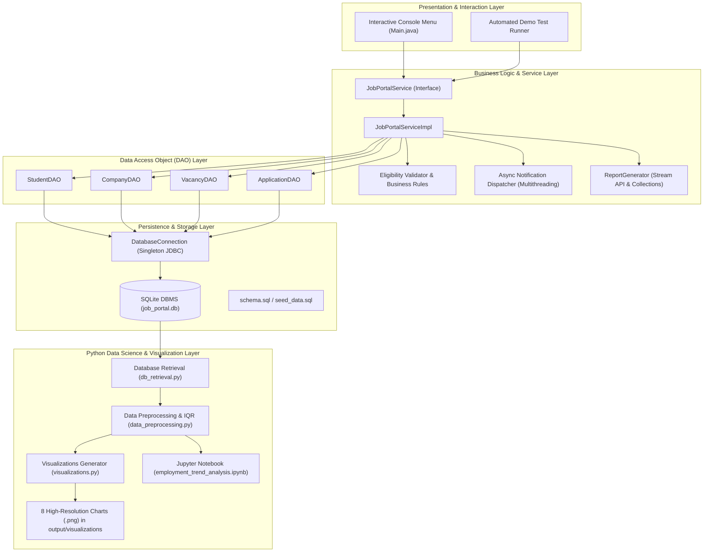
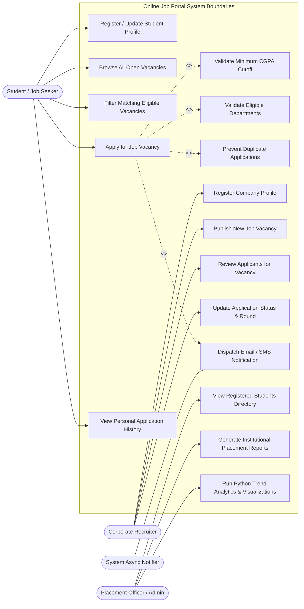
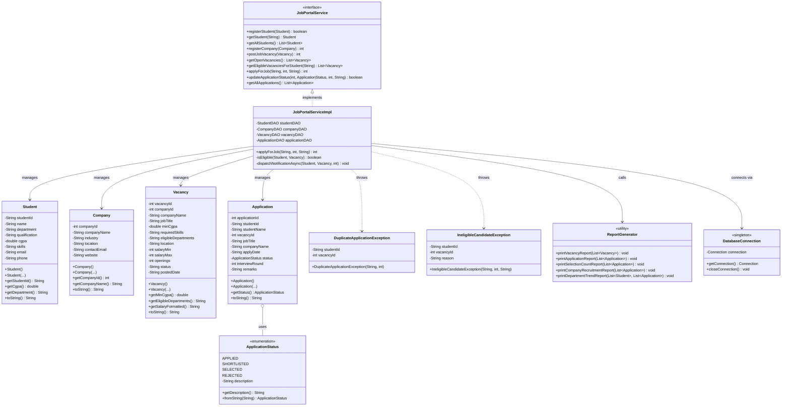
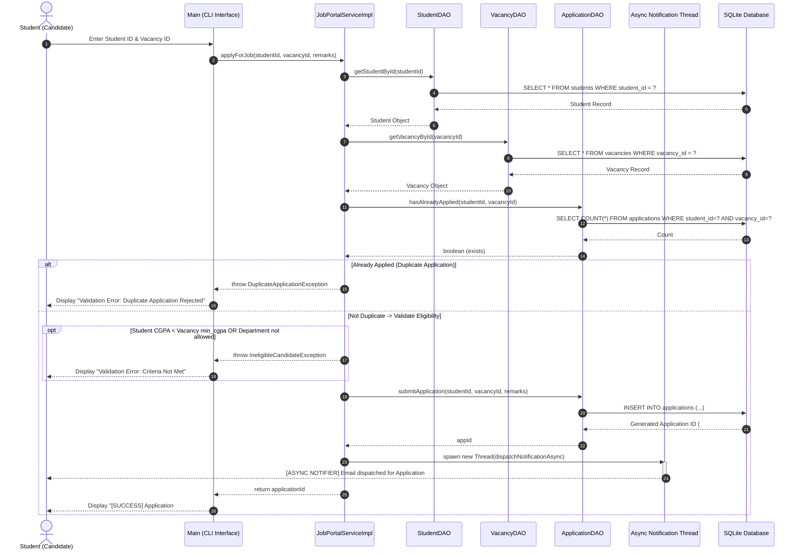

# SYSTEM DESIGN & UML DIAGRAMS SPECIFICATION
## Online Job Portal and Employment Trend Analysis System
### Scenario 22 | Department of Information Technology
**Velalar College of Engineering and Technology, Erode - 12**  
**Student:** Dharaneesh.K | **Reg No:** 732925ITR022 | **Class:** 25IT3A  
**Course:** 25ITT33 Software Engineering (Unit 2 & Unit 3)

---

## 1. OVERALL SYSTEM ARCHITECTURE

The system follows an enterprise **N-Tier Architectural Pattern** ensuring separation of concerns, high cohesion, low coupling, and maintainability.

---

## 2. UML USE CASE DIAGRAM

The Use Case Diagram illustrates the functional interactions between the primary actors (**Student**, **Corporate Recruiter**, **Placement Officer / Admin**, and **System Background Notifier**) and the system functions.

---

## 3. UML CLASS DIAGRAM

The Class Diagram documents the static object-oriented structure, class attributes, method signatures, visibility modifiers, and design relationships.

---

## 4. UML SEQUENCE DIAGRAM: JOB APPLICATION WORKFLOW

This sequence diagram details the runtime execution path, validation guards, and exception handling during a job application attempt.

