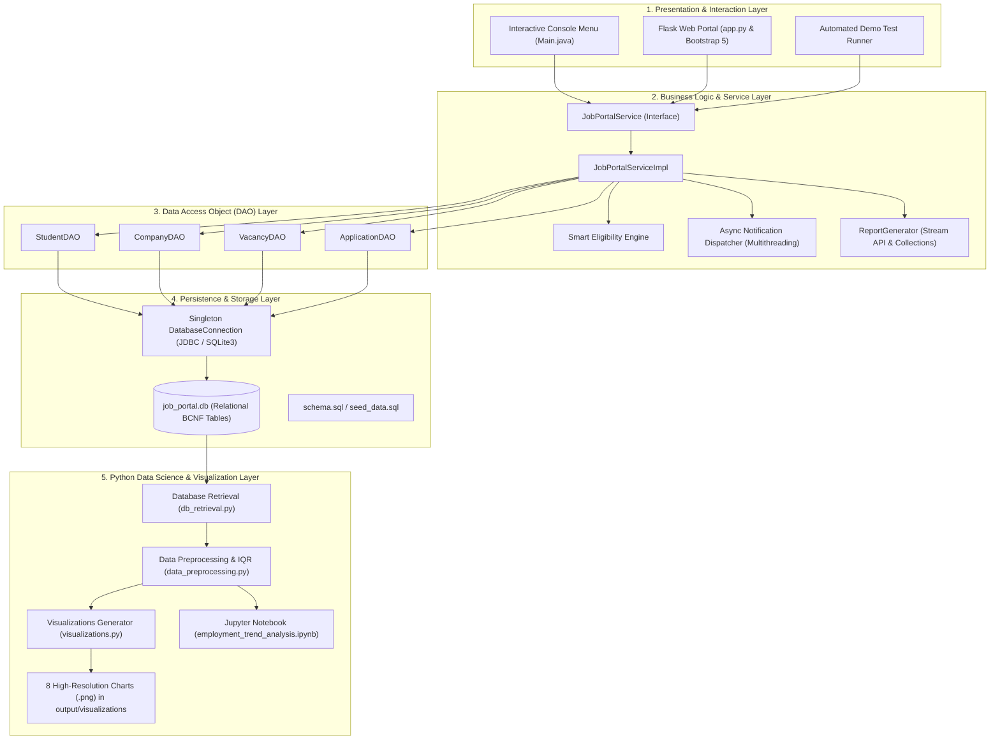
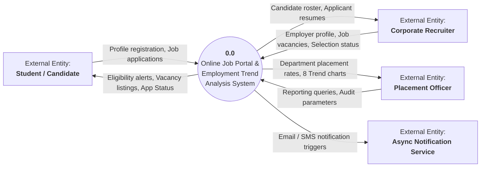
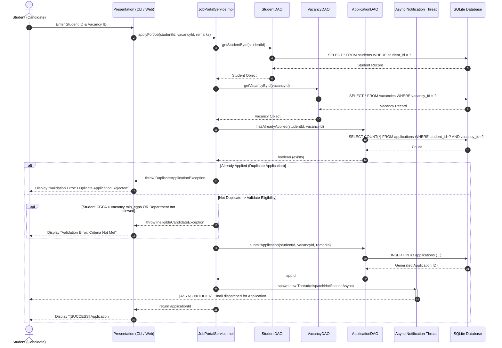
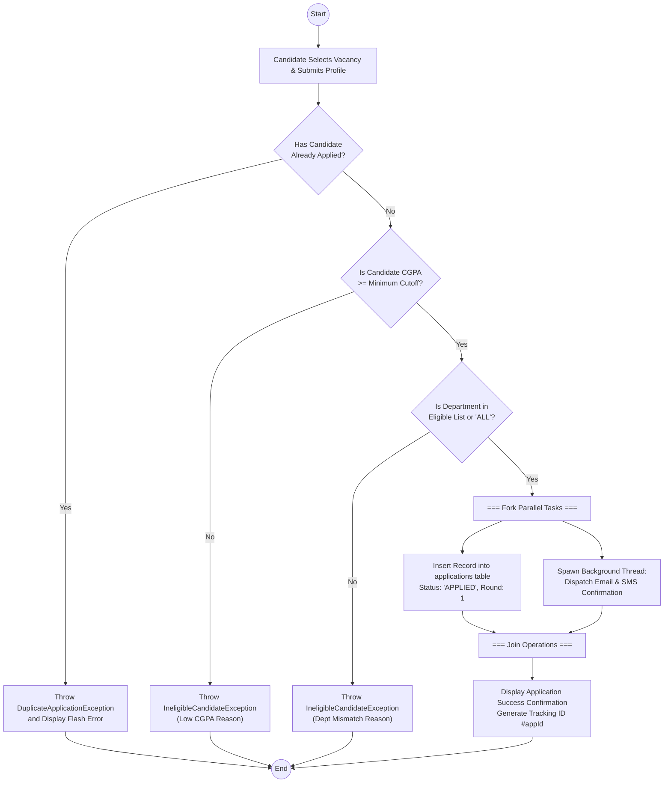
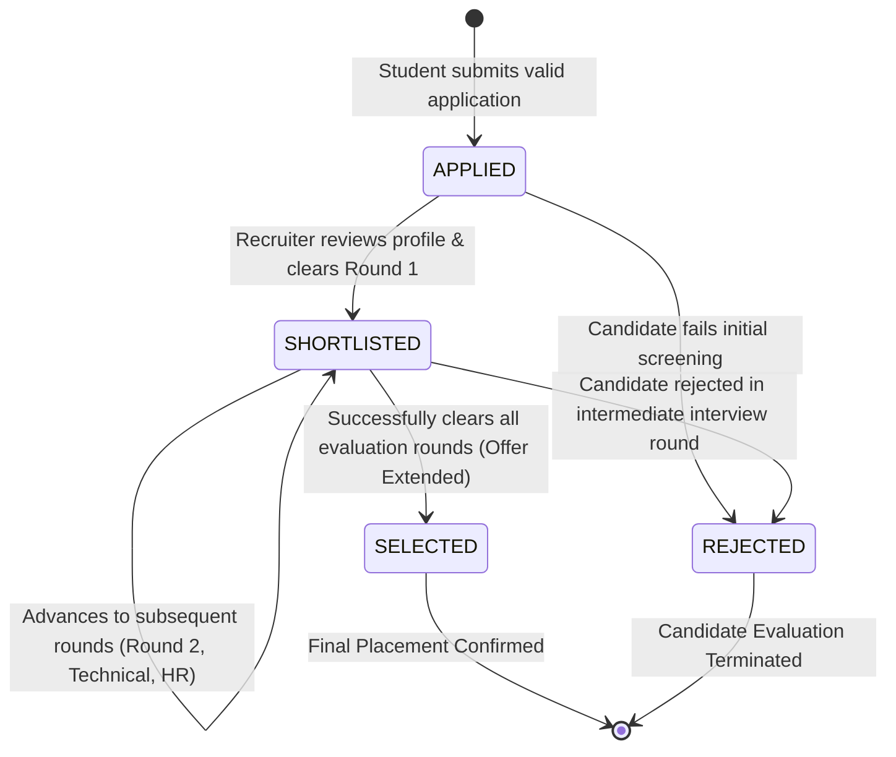
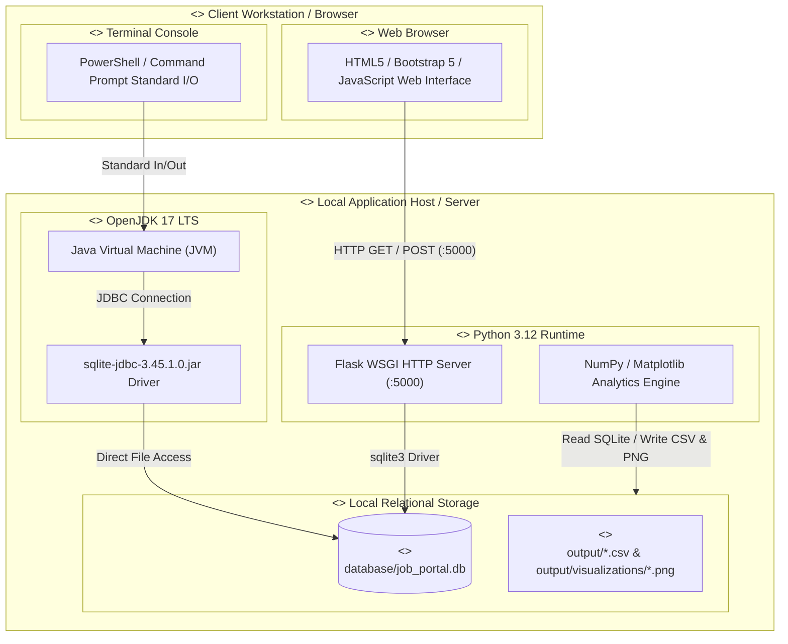

# SYSTEM DESIGN & UML DIAGRAMS SPECIFICATION
## Online Job Portal and Employment Trend Analysis System
### Scenario 22 | Department of Information Technology
**Velalar College of Engineering and Technology (Autonomous), Erode - 638012**  
**Student:** Dharaneesh.K | **Reg No:** 732925ITR022 | **Class:** 25IT3A  
**Course:** 25ITT33 Software Engineering (Unit 2: Analysis & Unit 3: System Design)

---

## TABLE OF SYSTEM DIAGRAMS

1. [Overall N-Tier System Architecture Diagram](#1-overall-n-tier-system-architecture)
2. [Data Flow Diagrams (DFD Level 0 & Level 1)](#2-data-flow-diagrams-dfd)
   - 2.1 [DFD Level 0: Context Diagram](#21-dfd-level-0-context-diagram)
   - 2.2 [DFD Level 1: Functional Decomposition Diagram](#22-dfd-level-1-functional-decomposition)
3. [UML Use Case Diagram](#3-uml-use-case-diagram)
4. [UML Class Diagram (Static Structure)](#4-uml-class-diagram)
5. [UML Sequence Diagram (Job Application Execution)](#5-uml-sequence-diagram)
6. [UML Activity Diagram (Application & Eligibility Workflow)](#6-uml-activity-diagram)
7. [UML State Machine / Statechart Diagram (Application Lifecycle)](#7-uml-state-machine-diagram)
8. [UML Component Diagram](#8-uml-component-diagram)
9. [UML Deployment Diagram](#9-uml-deployment-diagram)

---

## 1. OVERALL N-TIER SYSTEM ARCHITECTURE

The system enforces strict separation of concerns through an enterprise **N-Tier Layered Architecture Pattern** ensuring loose coupling, modularity, and high maintainability.



---

## 2. DATA FLOW DIAGRAMS (DFD)

### 2.1 DFD Level 0: Context Diagram
The Context Diagram establishes the boundary of the Online Job Portal system, depicting external entities and major information flows into and out of the central system process `0.0`.



### 2.2 DFD Level 1: Functional Decomposition
Decomposes the system into 5 primary logical subprocesses and illustrates interactions with relational data stores (`D1` through `D4`).

```mermaid
flowchart TD
    Student["Student"]
    Recruiter["Corporate Recruiter"]
    Admin["Placement Officer"]

    P1(("1.0<br/>Student Profile<br/>Management"))
    P2(("2.0<br/>Company & Vacancy<br/>Publishing"))
    P3(("3.0<br/>Eligibility & Application<br/>Processing"))
    P4(("4.0<br/>Recruitment Status<br/>Tracking"))
    P5(("5.0<br/>Reporting & Trend<br/>Analytics"))

    D1[("D1: Students Store")]
    D2[("D2: Companies Store")]
    D3[("D3: Vacancies Store")]
    D4[("D4: Applications Store")]

    Student -->|Profile info| P1
    P1 -->|Write record| D1

    Recruiter -->|Employer info| P2
    P2 -->|Write company| D2
    Recruiter -->|Job vacancy details| P2
    P2 -->|Write vacancy| D3

    Student -->|Apply request (student_id, vacancy_id)| P3
    D1 -->|Read candidate CGPA & Dept| P3
    D3 -->|Read Cutoff & Allowed Depts| P3
    P3 -->|Check duplicate & insert| D4
    P3 -->|Success confirmation / Ineligibility exception| Student

    Recruiter -->|Update interview round & status| P4
    P4 -->|Update record| D4
    P4 -->|Status update alert| Student

    Admin -->|Request institutional analytics| P5
    D1 -->|Student counts| P5
    D4 -->|Selection records| P5
    D3 -->|Salary benchmarks| P5
    P5 -->|Placement tables & 8 Visual Charts| Admin
```

---

## 3. UML USE CASE DIAGRAM

The Use Case Diagram captures all functional interactions between system actors (**Student**, **Corporate Recruiter**, **Placement Officer**, and **Background Async Notifier**) and defines formal `<<includes>>` and `<<triggers>>` dependencies.


---

## 4. UML CLASS DIAGRAM

The Class Diagram documents the static object-oriented structure, class attributes, method signatures, visibility modifiers, and design relationships.


---

## 5. UML SEQUENCE DIAGRAM: JOB APPLICATION WORKFLOW

Details runtime message exchange, validation guards, and asynchronous concurrency during a job application attempt.



---

## 6. UML ACTIVITY DIAGRAM

Models the step-by-step procedural control flow and decision diamonds of candidate job application processing.



---

## 7. UML STATE MACHINE DIAGRAM

Models the dynamic states and transitions of an **Application** entity from submission through multi-round evaluation to final placement.



---

## 8. UML COMPONENT DIAGRAM

Illustrates the software modular components, interfaces, and physical dependency wiring across tiers.

```mermaid
flowchart TB
    subgraph Presentation_Component ["Presentation Component"]
        FlaskApp["Web Controller (web/app.py)"]
        CLIMenu["Console CLI (src/.../Main.java)"]
        Templates["Bootstrap 5 Templates & HTML Views"]
    end

    subgraph Service_Component ["Business Logic & Service Component"]
        ServiceIf["<<interface>><br/>JobPortalService"]
        ServiceImpl["JobPortalServiceImpl"]
        Validator["InputValidator & Business Rules"]
        AsyncWorker["Async Notifier Thread"]
        ReportGen["ReportGenerator (Stream API)"]
    end

    subgraph DAO_Component ["Data Access Object Component"]
        StudentDAO["StudentDAO"]
        VacancyDAO["VacancyDAO"]
        ApplicationDAO["ApplicationDAO"]
        CompanyDAO["CompanyDAO"]
    end

    subgraph Persistence_Component ["Data Storage Component"]
        DBCreds["Singleton DatabaseConnection"]
        SQLiteFile[("job_portal.db (SQLite3)")]
    end

    subgraph Analytics_Component ["Python Data Science Component"]
        DBRetriever["db_retrieval.py"]
        Preprocessor["data_preprocessing.py (IQR Outliers)"]
        VizEngine["visualizations.py (8 Charts)"]
    end

    FlaskApp --> Templates
    FlaskApp --> ServiceIf
    CLIMenu --> ServiceIf
    ServiceIf <|.. ServiceImpl
    ServiceImpl --> Validator
    ServiceImpl --> AsyncWorker
    ServiceImpl --> ReportGen
    ServiceImpl --> StudentDAO
    ServiceImpl --> VacancyDAO
    ServiceImpl --> ApplicationDAO
    ServiceImpl --> CompanyDAO

    StudentDAO --> DBCreds
    VacancyDAO --> DBCreds
    ApplicationDAO --> DBCreds
    CompanyDAO --> DBCreds
    DBCreds --> SQLiteFile

    SQLiteFile --> DBRetriever
    DBRetriever --> Preprocessor
    Preprocessor --> VizEngine
```

---

## 9. UML DEPLOYMENT DIAGRAM

Details the physical execution nodes, client hardware devices, software runtime environments, and communication protocols.


