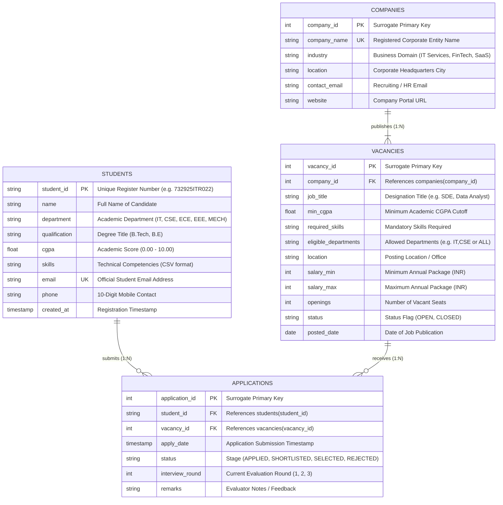

# DATABASE DESIGN, ER DIAGRAM, RELATIONAL MODEL & NORMALIZATION
## Online Job Portal and Employment Trend Analysis System
### Scenario 22 | Department of Information Technology
**Velalar College of Engineering and Technology, Erode - 12**  
**Student:** Dharaneesh.K | **Reg No:** 732925ITR022 | **Class:** 25IT3A  
**Course:** 25ITT31 Database Management Systems (Units 1, 2, 3, 4)

---

## 1. ENTITY-RELATIONSHIP (ER) DIAGRAM

The ER diagram defines the core business entities, their attributes (primary keys, foreign keys, multi-valued attributes, derived attributes), and relationship cardinalities.



### Cardinality Rationales:
1. **COMPANIES to VACANCIES (1 : N)**: A single corporate employer can publish multiple job vacancies across different departments and roles. Each vacancy belongs to exactly one company.
2. **STUDENTS to APPLICATIONS (1 : N)**: A student may submit applications to multiple distinct vacancies for which they are eligible.
3. **VACANCIES to APPLICATIONS (1 : N)**: A vacancy listing can receive multiple candidate applications.
4. **STUDENTS to VACANCIES (M : N)**: The many-to-many relationship between Students and Vacancies is decomposed and resolved by the associative associative entity **`APPLICATIONS`**, which enforces uniqueness on `(student_id, vacancy_id)` to satisfy Functional Requirement 4.

---

## 2. RELATIONAL SCHEMA MODEL

The formal relational schema representation in third normal form with primary keys underlined and foreign keys indicated:

```
STUDENTS(
    student_id [PK],
    name,
    department,
    qualification,
    cgpa,
    skills,
    email [UK],
    phone,
    created_at
)

COMPANIES(
    company_id [PK],
    company_name [UK],
    industry,
    location,
    contact_email,
    website
)

VACANCIES(
    vacancy_id [PK],
    company_id [FK -> COMPANIES.company_id],
    job_title,
    min_cgpa,
    required_skills,
    eligible_departments,
    location,
    salary_min,
    salary_max,
    openings,
    status,
    posted_date
)

APPLICATIONS(
    application_id [PK],
    student_id [FK -> STUDENTS.student_id],
    vacancy_id [FK -> VACANCIES.vacancy_id],
    apply_date,
    status,
    interview_round,
    remarks,
    CONSTRAINT UK_STUDENT_VACANCY UNIQUE(student_id, vacancy_id)
)
```

---

## 3. DATABASE NORMALIZATION ANALYSIS (1NF TO BCNF)

Normalization is the systematic process of decomposing database relations to eliminate data redundancy, insertion anomalies, update anomalies, and deletion anomalies.

### 3.1 Initial Unnormalized Form (UNF)
Consider a denormalized single flat table storing all placement data:
$$\text{UNF}(\underline{\text{student\_id}}, \underline{\text{vacancy\_id}}, \text{student\_name}, \text{dept}, \text{cgpa}, \text{skills}, \text{company\_name}, \text{industry}, \text{job\_title}, \text{salary\_min}, \text{salary\_max}, \text{apply\_date}, \text{status})$$
- **Problems**: Massive redundancy (repeating company details for every vacancy and applicant), insertion anomalies (cannot add a company without an applicant), and deletion anomalies (deleting the last applicant erases the company record).

---

### 3.2 First Normal Form (1NF)
**Definition**: A relation is in 1NF if and only if all underlying domains contain only atomic (indivisible) values, and there are no repeating groups.
- Every attribute contains single, scalar atomic values.
- Primary keys are established for all entity sets.
- `skills` and `required_skills` are stored as comma-delimited tokens in atomic TEXT fields, or modeled associatively.
- Result: All tables satisfy **1NF**.

---

### 3.3 Second Normal Form (2NF)
**Definition**: A relation is in 2NF if it is in 1NF and every non-prime attribute is fully functionally dependent on the entire primary key (no partial functional dependencies on composite keys).

- In the associative relation `APPLICATIONS`, if we used composite candidate key $(\text{student\_id}, \text{vacancy\_id})$:
  - Functional Dependencies:
    $$\{\text{student\_id}, \text{vacancy\_id}\} \rightarrow \{\text{apply\_date}, \text{status}, \text{interview\_round}, \text{remarks}\}$$
  - If `student_name` or `job_title` were left in `APPLICATIONS`:
    $$\text{student\_id} \rightarrow \text{student\_name} \quad \text{(Partial Dependency)}$$
    $$\text{vacancy\_id} \rightarrow \text{job\_title} \quad \text{(Partial Dependency)}$$
- **Decomposition**: Non-key descriptive attributes were factored out into independent entity tables `STUDENTS` and `VACANCIES`.
- Therefore, in our schema:
  - `STUDENTS` has single-attribute PK `student_id`.
  - `COMPANIES` has single-attribute PK `company_id`.
  - `VACANCIES` has single-attribute PK `vacancy_id`.
  - `APPLICATIONS` has surrogate PK `application_id` and compound unique key $(\text{student\_id}, \text{vacancy\_id})$.
- Result: **Zero partial dependencies exist $\implies$ Schema is in 2NF.**

---

### 3.4 Third Normal Form (3NF)
**Definition**: A relation is in 3NF if it is in 2NF and no non-prime attribute is transitively dependent on the primary key ($X \rightarrow Y$ and $Y \rightarrow Z$ where $Z$ is non-prime is prohibited).

- If `VACANCIES` included `company_name`, `industry`, and `company_location`:
  $$\text{vacancy\_id} \rightarrow \text{company\_id} \quad \text{and} \quad \text{company\_id} \rightarrow \text{company\_name}$$
  This would constitute a transitive functional dependency ($\text{vacancy\_id} \rightarrow \text{company\_name}$).
- **Decomposition**: `COMPANIES` is separated into its own table, storing `company_name`, `industry`, `location`, `contact_email`, and `website`. `VACANCIES` stores only `company_id` as a foreign key.
- Similarly, in `STUDENTS`:
  $$\text{student\_id} \rightarrow \{\text{name}, \text{department}, \text{qualification}, \text{cgpa}, \text{skills}, \text{email}, \text{phone}\}$$
  No transitive dependencies exist among non-key attributes.
- Result: **Schema strictly satisfies 3NF.**

---

### 3.5 Boyce-Codd Normal Form (BCNF)
**Definition**: A relation is in BCNF if and only if for every functional dependency $X \rightarrow Y$, the determinant $X$ is a superkey.

1. **Table: `STUDENTS`**
   - $FD_1: \text{student\_id} \rightarrow \{\text{name}, \text{department}, \text{qualification}, \text{cgpa}, \text{skills}, \text{email}, \text{phone}\}$
     - Determinant $\text{student\_id}$ is the Primary Key (Superkey) $\implies$ **BCNF Valid**.
   - $FD_2: \text{email} \rightarrow \{\text{student\_id}, \text{name}, \dots\}$
     - Determinant $\text{email}$ is a Candidate Key (Unique Key) $\implies$ **BCNF Valid**.

2. **Table: `COMPANIES`**
   - $FD_1: \text{company\_id} \rightarrow \{\text{company\_name}, \text{industry}, \text{location}, \text{contact\_email}, \text{website}\}$
     - Determinant $\text{company\_id}$ is the Primary Key $\implies$ **BCNF Valid**.
   - $FD_2: \text{company\_name} \rightarrow \{\text{company\_id}, \dots\}$
     - Determinant $\text{company\_name}$ is a Candidate Key $\implies$ **BCNF Valid**.

3. **Table: `VACANCIES`**
   - $FD_1: \text{vacancy\_id} \rightarrow \{\text{company\_id}, \text{job\_title}, \text{min\_cgpa}, \text{required\_skills}, \text{eligible\_departments}, \text{location}, \text{salary\_min}, \text{salary\_max}, \text{openings}, \text{status}, \text{posted\_date}\}$
     - Determinant $\text{vacancy\_id}$ is the Primary Key $\implies$ **BCNF Valid**.

4. **Table: `APPLICATIONS`**
   - $FD_1: \text{application\_id} \rightarrow \{\text{student\_id}, \text{vacancy\_id}, \text{apply\_date}, \text{status}, \text{interview\_round}, \text{remarks}\}$
     - Determinant $\text{application\_id}$ is the Primary Key $\implies$ **BCNF Valid**.
   - $FD_2: \{\text{student\_id}, \text{vacancy\_id}\} \rightarrow \{\text{application\_id}, \text{apply\_date}, \text{status}, \text{interview\_round}, \text{remarks}\}$
     - Determinant $\{\text{student\_id}, \text{vacancy\_id}\}$ is a Candidate Key (Enforced by `UNIQUE` constraint) $\implies$ **BCNF Valid**.

**Conclusion**: In every table of the database schema, all functional determinants are superkeys. Thus, the database is in **Boyce-Codd Normal Form (BCNF)**, offering maximum normalization, minimal redundancy, and complete data integrity.

---

## 4. INTEGRITY CONSTRAINTS & INDEXING STRATEGY

### 4.1 Referential Integrity
- `ON DELETE CASCADE` configured on foreign keys in `vacancies` and `applications` to ensure relational consistency.
- `PRAGMA foreign_keys = ON;` explicitly enabled on every SQLite connection.

### 4.2 Domain Constraints
- `CHECK(cgpa >= 0.0 AND cgpa <= 10.0)`
- `CHECK(salary_min >= 0 AND salary_max >= salary_min)`
- `CHECK(openings > 0)`
- `CHECK(status IN ('APPLIED', 'SHORTLISTED', 'SELECTED', 'REJECTED'))`

### 4.3 Indexing for Query Optimization
To optimize high-frequency analytical queries and joins, secondary B-Tree indexes are defined:
- `idx_students_dept` on `students(department)`
- `idx_vacancies_company` on `vacancies(company_id)`
- `idx_applications_student` on `applications(student_id)`
- `idx_applications_vacancy` on `applications(vacancy_id)`
- `idx_applications_status` on `applications(status)`
