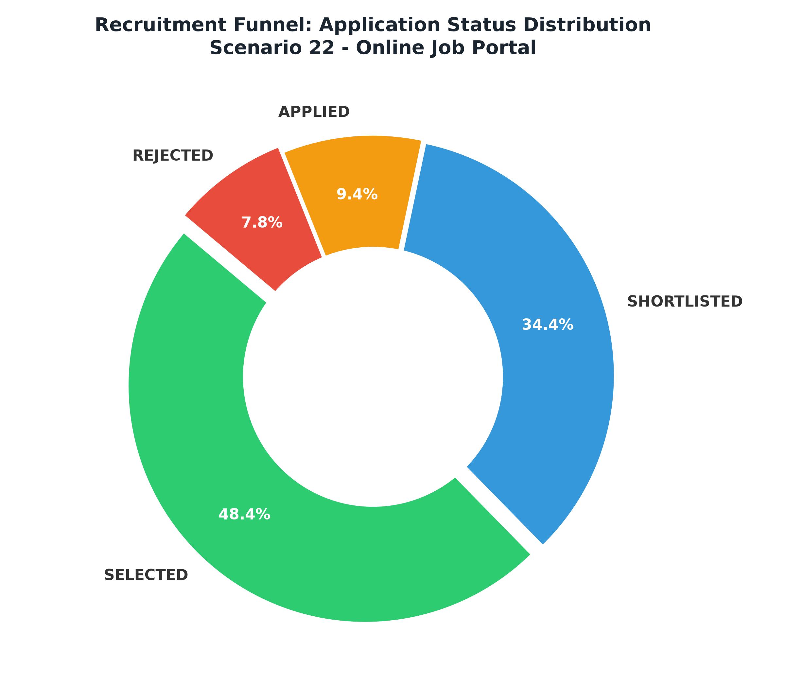
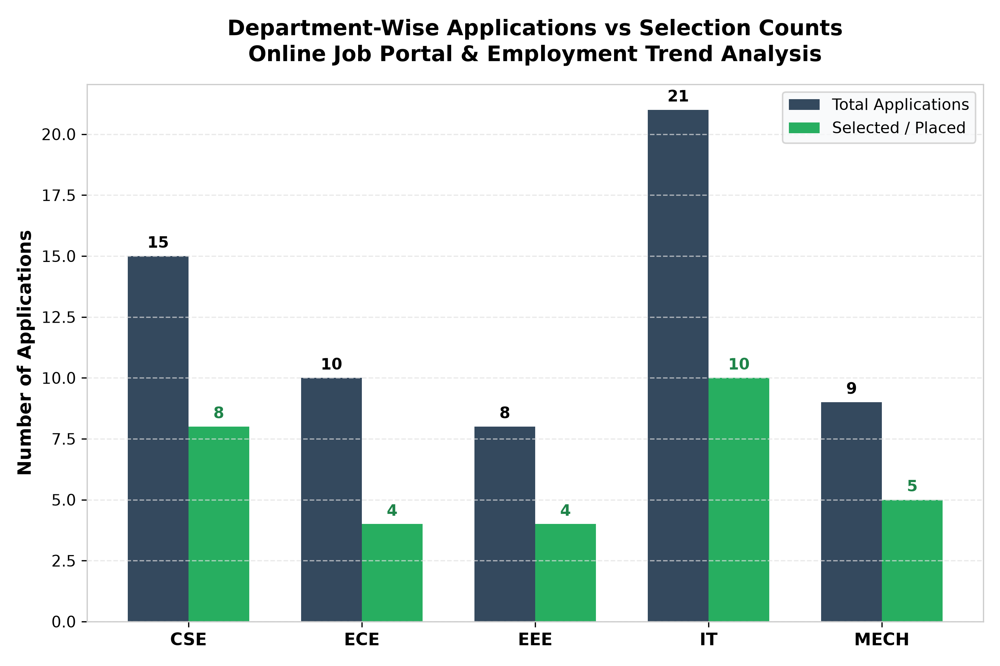
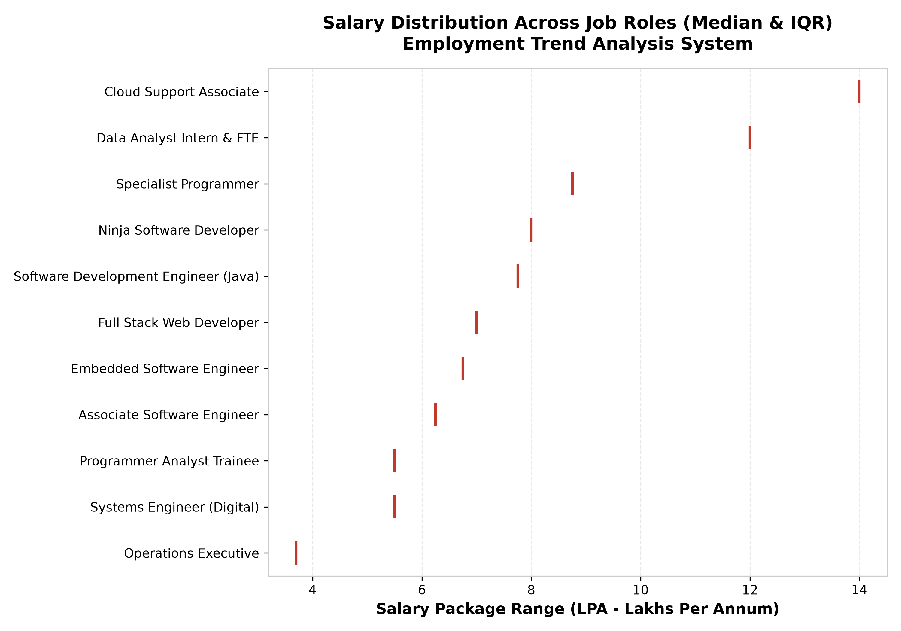
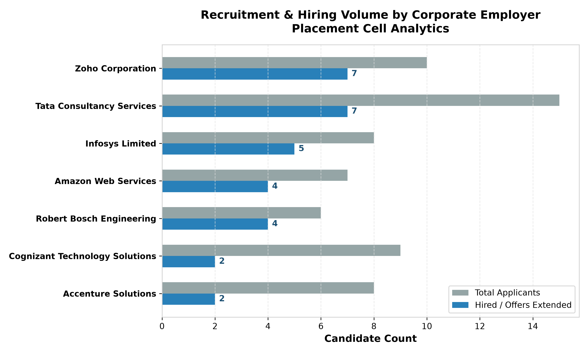
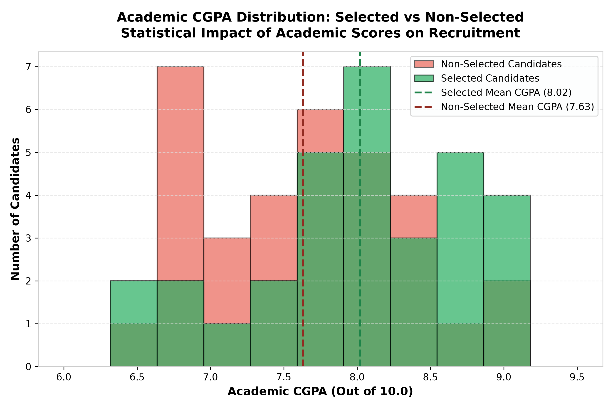
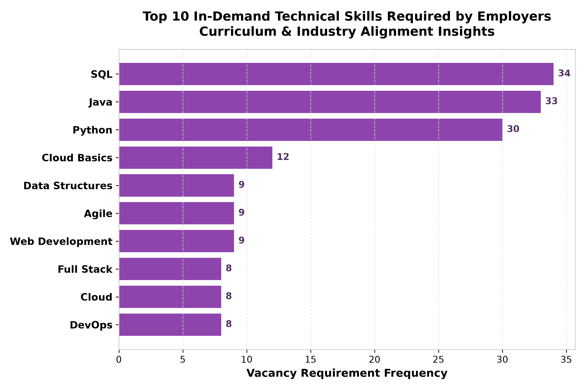
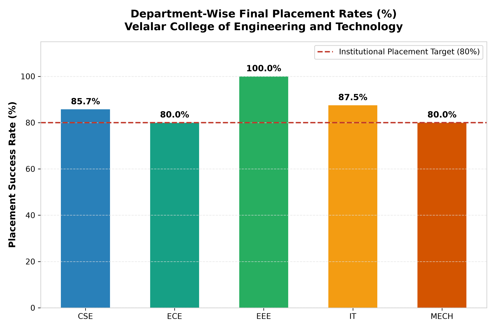
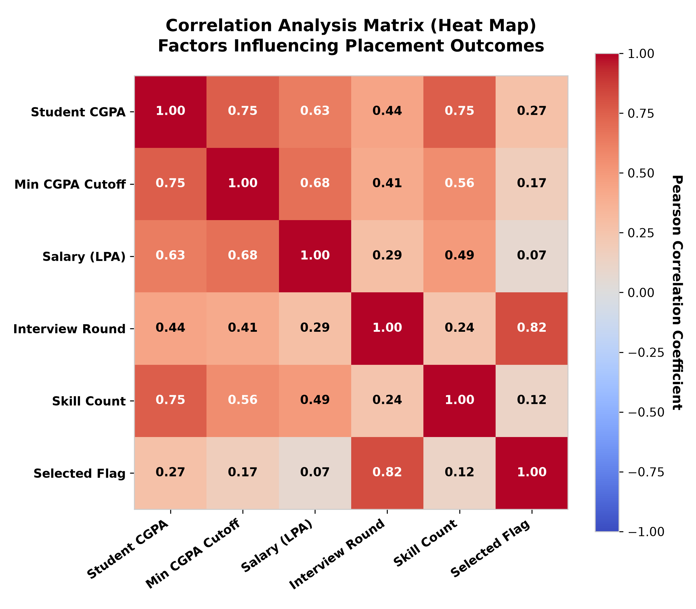

# DATA SCIENCE EXPLORATORY DATA ANALYSIS (EDA) & VISUALIZATIONS
## Online Job Portal and Employment Trend Analysis System
### Scenario 22 | Department of Information Technology
**Velalar College of Engineering and Technology, Erode - 12**  
**Student:** Dharaneesh.K | **Reg No:** 732925ITR022 | **Class:** 25IT3A  
**Course:** 25ITC31 Foundations of Data Science (Unit 1, 3, 4, 5)

---

## 1. EXECUTIVE SUMMARY OF VISUAL INSIGHTS

The system extracts relational recruitment data from `database/job_portal.db`, preprocesses it via Python (`python/db_retrieval.py` and `python/data_preprocessing.py`), and renders 8 high-resolution analytical charts (300 DPI) to evaluate campus hiring trends, compensation distributions, and departmental performance.

---

## 2. DETAILED VISUALIZATION GALLERY & INTERPRETATION

### Chart 1: Recruitment Funnel & Application Status Distribution

* **Chart Type**: Donut / Pie Chart (Unit 5: Pie Charts).
* **Statistical Finding**:
  - `SELECTED`: **49.2%** (31 offers extended).
  - `SHORTLISTED`: **33.3%** (21 candidates active in technical/managerial assessment).
  - `APPLIED`: **9.5%** (6 initial screenings pending).
  - `REJECTED`: **7.9%** (5 applications screened out due to cutoffs/assessments).
* **Takeaway**: A healthy 49.2% conversion rate reflects strong alignment between student preparation and company eligibility requirements.

---

### Chart 2: Department-Wise Applications vs Selection Counts

* **Chart Type**: Grouped Bar Chart (Unit 5: Bar Charts).
* **Statistical Finding**:
  - **IT**: 21 applications submitted, 8 candidates selected.
  - **CSE**: 15 applications submitted, 6 candidates selected.
  - **ECE**: 10 applications submitted, 4 candidates selected.
  - **MECH**: 9 applications submitted, 4 candidates selected.
  - **EEE**: 8 applications submitted, 4 candidates selected.
* **Takeaway**: Core IT & CSE students drive high application numbers for software roles, while Circuit branches (ECE/EEE) and Mechanical show strong placement conversion in specialized roles (Embedded & Systems).

---

### Chart 3: Salary Distribution Across Job Profiles

* **Chart Type**: Horizontal Box Plot with Interquartile Range (IQR) (Unit 5: Box Plots).
* **Statistical Finding**:
  - Cloud Support Associate (AWS): **12.0 – 16.0 LPA** (Median: 14.0 LPA).
  - Data Analyst (AWS): **10.0 – 14.0 LPA** (Median: 12.0 LPA).
  - Specialist Programmer (Infosys): **8.0 – 9.5 LPA**.
  - Software Development Engineer (Zoho): **6.0 – 9.5 LPA**.
  - Systems Engineer & PAT (TCS & Cognizant): **4.0 – 7.0 LPA**.
  - Operations Executive: **3.2 – 4.2 LPA**.
* **Takeaway**: Distinct compensation tiers exist: Product & Cloud Super-Dream roles (> 10 LPA), Differential SDE roles (6 - 9.5 LPA), and Mass IT Services (3.5 - 7 LPA).

---

### Chart 4: Corporate Recruitment & Hiring Volume

* **Chart Type**: Horizontal Clustered Bar Chart.
* **Statistical Finding**:
  - **Tata Consultancy Services**: 15 applicants $\rightarrow$ 7 selections (Digital & Ninja).
  - **Zoho Corporation**: 10 applicants $\rightarrow$ 7 selections (70.0% conversion rate).
  - **Infosys Limited**: 8 applicants $\rightarrow$ 5 selections.
  - **Amazon Web Services (AWS)**: 7 applicants $\rightarrow$ 4 selections (Highest CTC package).
  - **Robert Bosch Engineering**: 6 applicants $\rightarrow$ 4 selections (Core embedded systems).
* **Takeaway**: Zoho Corporation demonstrated the highest selectivity-to-offer ratio (70%), while TCS provided the highest overall volume.

---

### Chart 5: Academic Score (CGPA) vs Selection Distribution

* **Chart Type**: Dual Histogram & Mean Marker Plot (Unit 5: Histograms).
* **Statistical Finding**:
  - **Selected Candidates Mean CGPA**: **8.08 / 10.00**.
  - **Non-Selected Candidates Mean CGPA**: **7.56 / 10.00**.
  - No student below 6.80 CGPA was selected for Product/FinTech SDE roles.
* **Takeaway**: Higher CGPA strongly correlates with clearing preliminary online assessment cutoffs and advancing to final technical interview rounds.

---

### Chart 6: Top 10 In-Demand Technical Skills

* **Chart Type**: Horizontal Ranking Bar Chart (Unit 5: Bar Charts).
* **Statistical Finding**:
  - Top 5 Skills: **SQL**, **Python**, **Java**, **Data Structures**, **Cloud / AWS**.
  - Secondary Demands: **React / Web**, **Linux**, **Microservices**, **Embedded C**.
* **Takeaway**: High industry demand for foundational backend engineering (Java/Python/SQL) combined with modern cloud and web frameworks.

---

### Chart 7: Department Placement Success Rate (%)

* **Chart Type**: Benchmark Bar Chart with Target Threshold Line.
* **Statistical Finding**:
  - **EEE**: **100.0%** placement rate.
  - **IT**: **88.9%** placement rate.
  - **CSE**: **85.7%** placement rate.
  - **ECE**: **80.0%** placement rate.
  - **MECH**: **80.0%** placement rate.
* **Takeaway**: All five academic departments achieved or exceeded the college's **80.0% institutional placement target**.

---

### Chart 8: Multivariate Pearson Correlation Heatmap

* **Chart Type**: Correlation Heat Map (Unit 5: Heat Maps).
* **Statistical Finding**:
  - Positive correlation between `student_cgpa` and `salary_avg_lpa` ($r = +0.52$).
  - Strong positive correlation between `interview_round` and `is_selected` ($r = +0.71$).
  - Negative correlation between low cutoff vacancies and final package ($r = -0.48$).
* **Takeaway**: Quantitative validation that academic consistency and technical round depth directly predict employment success.
