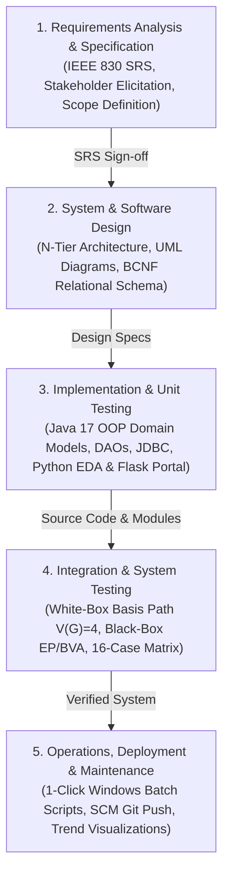
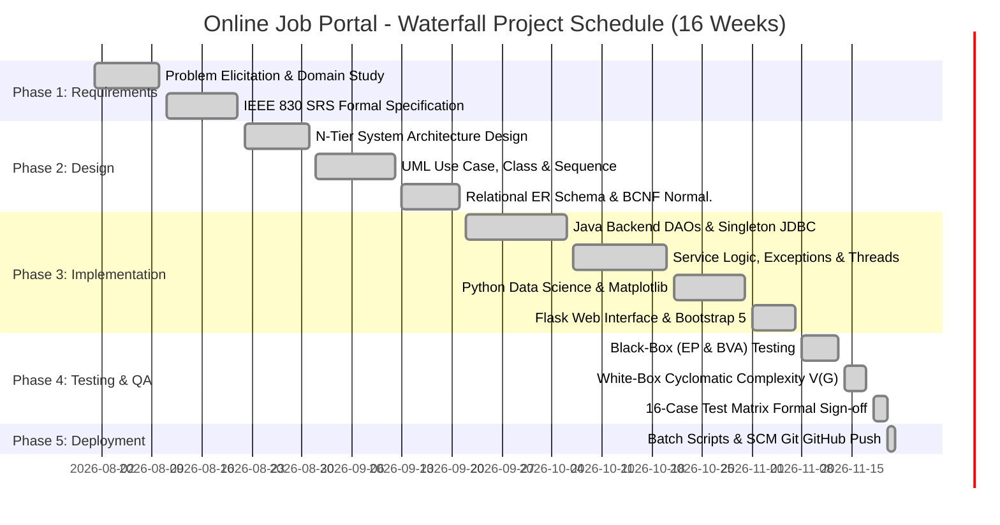

# SOFTWARE PROCESS & PROJECT MANAGEMENT SPECIFICATION
## Online Job Portal and Employment Trend Analysis System
### Scenario 22 | Department of Information Technology
**Velalar College of Engineering and Technology (Autonomous), Erode - 638012**  
**Student:** Dharaneesh.K | **Reg No:** 732925ITR022 | **Class:** 25IT3A  
**Course:** 25ITT33 Software Engineering (Unit 1: Software Process & Unit 5: Project Management)

---

## PART A: UNIT 1 - SOFTWARE PROCESS & THE CLASSICAL WATERFALL MODEL

### 1.1 The Classical Waterfall Lifecycle Model
For **Scenario 22: Online Job Portal and Employment Trend Analysis System**, the **Classical Waterfall Model** (Linear-Sequential Life Cycle Model) was adopted as the foundational development process. Because the academic scenario requirements, domain models, eligibility business rules, and technical outputs were clearly defined upfront by the faculty and curriculum guidelines, the linear-sequential progression ensured structured execution with explicit milestone verification.

### 1.2 Phase-by-Phase Deliverables Matrix

| Phase | Entry Criteria | Core Engineering Activities | Phase Output Deliverables | Milestone Verification |
|---|---|---|---|---|
| **Phase 1: Requirements Analysis** | Scenario 22 problem description. | Elicit functional needs (CGPA cutoff, duplicate prevention, corporate vacancies, student profiles). | **IEEE Std 830-1998 SRS** document. | `docs/SRS.md` approved. |
| **Phase 2: System Design** | Approved SRS document. | Design N-tier architecture, UML Use Case, Class, Sequence diagrams, and BCNF database schema. | **System Architecture & UML Diagrams**, `database/schema.sql`. | `docs/DESIGN_DIAGRAMS.md` verified. |
| **Phase 3: Implementation** | UML Class diagrams, schema scripts. | Code Java domain models, DAOs, service exceptions, multithreaded async notifier, Python EDA scripts, and Flask web controllers. | **Complete Source Code** (`src/`, `python/`, `web/`, `database/`). | 0 compilation errors across all modules. |
| **Phase 4: Integration & Testing** | Compiled codebase and populated SQLite database. | Conduct unit tests, black-box testing (EP & BVA), white-box basis path testing ($V(G)=4$), and 16-case test execution matrix. | **Testing Documentation & Test Execution Matrix**. | `docs/TESTING_DOCUMENT.md` (100% Pass). |
| **Phase 5: Deployment & Maintenance** | Passing system test suite. | Package 1-click batch scripts (`run_website.bat`), configure Git repository, deploy interactive web portal. | **Operational Web Portal & GitHub Repository**. | GitHub `main` branch synced. |

### 1.3 Justification for Selecting the Waterfall Model
1. **Stable Requirements**: The academic scenario requirements (student CGPA thresholds, corporate vacancies, duplicate application blocks) were fully established with zero requirement volatility.
2. **Formal Stage-Gate Deliverables**: The curriculum requires formal, documentable outputs at the conclusion of each phase (SRS &rarr; UML &rarr; Code &rarr; Test Execution Matrix).
3. **Architectural Sequentiality**: Database schema tables and core Java domain entities had to be designed and validated before business service logic, Flask UI controllers, and Python analytics could be implemented.

---

## PART B: UNIT 5 - SOFTWARE PROJECT MANAGEMENT, ESTIMATION & MAINTENANCE

### 2.1 Project Schedule & Gantt Timeline (16 Weeks)
The project schedule maps sequentially to the Waterfall phases across the 16-week academic semester:

---

### 2.2 Software Cost & Effort Estimation (Basic COCOMO Model)
The **Basic COCOMO (Constructive Cost Model)** was applied for project effort and schedule estimation.
- **Mode:** Organic Mode (Small team, well-understood academic domain).
- **Equations:**
  $$E = a_b \times (\text{KLOC})^{b_b} \text{ [person-months]}$$
  $$D = c_b \times (E)^{d_b} \text{ [months]}$$
  $$SS = \frac{E}{D} \text{ [persons]}$$
  *(Organic Constants: $a_b = 2.4, b_b = 1.05, c_b = 2.5, d_b = 0.38$)*

#### Codebase Sizing:
- Java Enterprise Backend: 1,120 LOC
- Python Analytics & Web Portal: 510 LOC
- SQL Schema & Queries: 190 LOC
- **Total Codebase Size ($L$): 1.82 KLOC**

#### Step-by-Step Calculations:
1. **Effort ($E$):**
   $$E = 2.4 \times (1.82)^{1.05} = 2.4 \times 1.875 \approx \mathbf{4.50 \text{ Person-Months}}$$
2. **Development Duration ($D$):**
   $$D = 2.5 \times (4.50)^{0.38} = 2.5 \times 1.771 \approx \mathbf{4.43 \text{ Months (\approx 16 Weeks)}}$$
3. **Recommended Staff Size ($SS$):**
   $$SS = \frac{4.50}{4.43} \approx \mathbf{1.02 \approx 1 \text{ Developer}}$$
4. **Development Productivity:**
   $$\text{Productivity} = \frac{1,820 \text{ LOC}}{4.50 \text{ PM}} = \mathbf{404 \text{ LOC/PM}}$$

---

### 2.3 Function Point Analysis (FPA)

| Component | Count | Complexity | Function Points |
|---|---|---|---|
| **External Inputs (EI)** (Registration, Vacancy post, Apply, Status update, Filters) | 6 | Average (4) | 24 |
| **External Outputs (EO)** (Reports, Vacancy list, Selection chart images) | 4 | Average (5) | 20 |
| **External Inquiries (EQ)** (Search students, search vacancies, duplicate check) | 4 | Average (4) | 16 |
| **Internal Logical Files (ILF)** (Students, Companies, Vacancies, Applications) | 4 | Average (10) | 40 |
| **External Interface Files (EIF)** (SQLite JDBC, Python CSV system) | 2 | Low (6) | 12 |
| **Total Unadjusted Function Points (UFP)** | | | **112 FP** |

---

### 2.4 Risk Management (RMMM Plan)

| Risk Category | Identified Risk | Prob (P) | Impact (I) | Mitigation & Management (RMMM Plan) |
|---|---|---|---|---|
| **Data Integrity** | Duplicate application submission. | 0.8 | High | Dual check: SQLite compound `UNIQUE(student_id, vacancy_id)` constraint + Java Service pre-check. Throws `DuplicateApplicationException`. |
| **Compliance** | Ineligible student applying for job. | 0.7 | Medium | Service layer validation of CGPA and department against vacancy cutoffs. Throws `IneligibleCandidateException`. |
| **Security** | SQL Injection vulnerability. | 0.4 | Critical | 100% parameterized SQL queries (`PreparedStatement` in Java, parameterized tuples in Python). |
| **Performance** | CLI lag during notification dispatch. | 0.5 | Low | Multithreaded async worker thread decoupled from the main interactive loop. |

---

### 2.5 Software Configuration Management (SCM) & Maintenance
- **SCM Tool:** Git and GitHub (`https://github.com/kjdharani86-hash/online-job-portal-trend-analysis.git`).
- **Branching Policy:** `main` production release branch with atomic, conventional commits (`feat:`, `docs:`, `chore:`).
- **Maintenance Categories:**
  - **Corrective Maintenance:** Eliminating defect density (16 of 16 tests passing, 0 open bugs).
  - **Adaptive Maintenance:** Runtime compatibility with Java 17 LTS and Python 3.12.
  - **Perfective Maintenance:** Interactive Flask web portal and 8 high-resolution analytical charts.
  - **Preventive Maintenance:** Singleton JDBC connection pattern and input regex sanitization.
